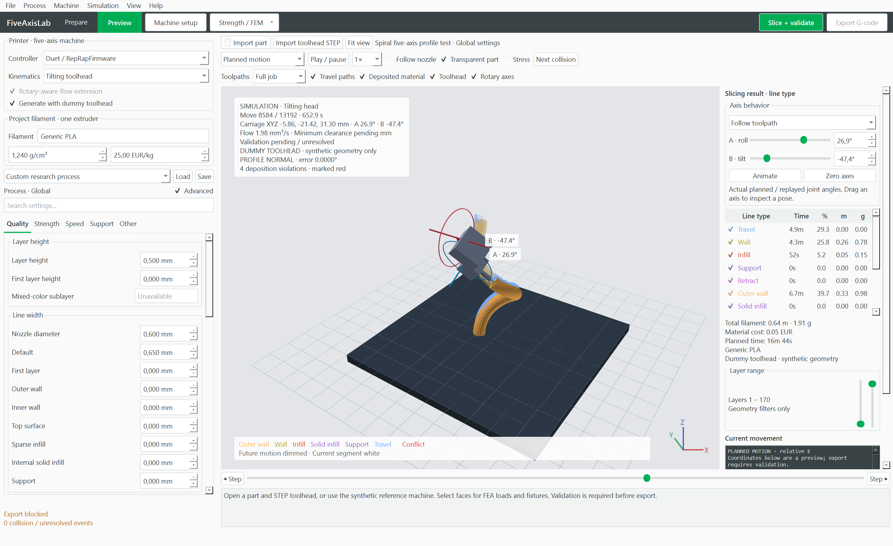

# FiveAxisLab 0.3.0

Independent C++17 / Qt 6 / OpenGL research application for five-axis FFF. Windows x64 portable build, shared headless core, AGPL-3.0-or-later. This is an initial research implementation, with remaining qualification work recorded in [docs/VALIDATION.md](docs/VALIDATION.md).

## Run

Extract the locally packaged `dist/FiveAxisLab-0.3.0-win64.zip` and run `FiveAxisLab.exe`. No SDK or Python is needed to run the packaged desktop app. The portable folder also contains `fiveaxis_cli.exe`, example projects, CAD fixtures, controller integration, dependency notices and validation reports. Binary packages and the SDK are excluded from Git; a fresh clone can produce them using the build instructions below.



Version 0.3.3 adds **Standard XYZ · 3-axis** for normal printers, with conformal non-planar layers, a planar base, a slope limit and an upright nozzle. **Simulation → Open 3-axis non-planar test** previews XYZ paths with no rotary movement. Generic/Marlin, Duet and stock Klipper output contains only Cartesian motion and E. [Controls, output and qualification limits](docs/THREE_AXIS_NONPLANAR.md).

Version 0.3.2 adds **Nozzle perpendicular to profile**, independent of FEM. **Simulation → Open spiral five-axis test** generates sections along a centerline and coordinated bed/head motion that holds the nozzle normal to each section. Preview shows the active plane and orientation error. Profile guides round-trip with the project; generation, validation and export reject lost alignment. The existing S-curve preview is regenerated with a guide. [Profile controls and guide format](docs/PROFILE_NORMAL.md).

Version 0.3.1 adds **Preview → Axis behavior**. Follow the recorded toolpath angles, drag **Manual tilt / roll** controls, or select **Animated tilt / roll**. Rotary-bed A/C and tilting-head A/B use calibrated pivots, link attachments and TCP compensation; rings mark the actual axis locations. Manual/animated poses pause the deposited prefix, preserve the project and disable export. **Simulation → Open rotary-bed / tilting-head axis demonstration** opens a synthetic, non-printing sweep with coordinated XYZ and rotary motion. See [axis preview controls](docs/AXIS_PREVIEW.md).

Version 0.3 adds the Orca-style **Prepare / Preview** workspace, an inline **Quality / Strength / Speed / Support / Other** sidebar, settings search, a screenshot-reference preset, filament/time/cost estimates, layer-range sliders and bead/path visibility by line type. New settings generate real surface patterns, shell thicknesses, alternating walls, compensation, speed limits, skirts and brims. STEP import has live linear/angular tessellation controls and a component/facet preview. [Implemented and unavailable controls](docs/WORKSPACE.md) lists the exact boundary; scarf, tree support, ironing, multi-material and full Orca engine integration remain outstanding.

Version 0.2 adds **Toolpaths → Full job / Up to nozzle / Current layer**, travel and deposited-material visibility controls, and role colors for outer walls, inner walls, infill, solid fill and supports. **Generate with dummy toolhead** uses synthetic collision geometry while retaining the imported STEP assembly. **Process settings · Orca options** exposes widths, wall order, shell layers, infill patterns, seam placement, speeds and Z hop. Select **Normal / Reduced / No supports**; unsupported deposition remains checked. [Supported controls and Orca preset import](docs/PROCESS_SETTINGS.md).

The initial screen contains a synthetic machine and demonstration job. Open `examples/reference-bed.5axis` for a checked trajectory, `examples/head-sync.5axis` for compensated head motion, or `examples/curved-stress.5axis` for an unvalidated directional-stress slicing example. The larger curved example exceeds the current validation benchmark's runtime budget and remains blocked. These are synthetic fixtures, not a calibrated printer.

1. Import printable STL, OBJ, 3MF or STEP geometry. Geometry is centered on XY and placed on Z=0; the placement is retained for FEM alignment.
2. Import the complete toolhead STEP assembly. Open **Machine setup / toolhead STEP**, select exactly one nozzle, set its CAD tip and axis, assign moving links and calibrate pivots / offsets. Drag to orbit and pick the nozzle tip. All imported physical components participate by default. Mark visual-only components deliberately.
3. Add or import bed, fixtures and other bodies. Choose machine-world or rotary-bed attachment. Bed body names include `Bed` so the limited first-layer contact rule can identify them. Save calibration through **File → Save machine profile**.
4. Select fixed / loaded faces and open **Loads, fixtures and material**, then solve linear static tetrahedral FEA. Alternatively choose **Import FEM · Autodesk Fusion**.
5. Choose layer height, bead width, infill and curved layers. **Slice + validate** generates motion and runs geometry checks in a worker. **Try collision avoidance** uses bounded orientation / IK search and joint-space RRT-Connect. Red timeline ticks and contact markers identify conflicts. Incomplete coverage, unsupported deposition and unresolved clearance block export.
6. Play, scrub backward, step, change preview speed or follow the nozzle. The part grows from the deposited prefix of the same trajectory. Validation does not depend on playback.
7. Select Duet / RepRapFirmware or Klipper, regenerate and validate, then export. **Exported G-code replay** parses generated output and runs geometry validation again. Calibration changes invalidate the previous report.

## Fusion FEM import

Autodesk's documented workflow exports the active simulation result plot to VTU: [Fusion simulation result export](https://www.autodesk.com/support/technical/article/caas/sfdcarticles/sfdcarticles/How-to-export-Fusion-360-simulation-results.html).

The importer accepts VTK XML tetrahedral unstructured grids (linear 4-node or quadratic 10-node), including binary / compressed data. Choose point or cell association. Supply a symmetric 9-component tensor, a 6-component tensor ordered **XX YY ZZ XY YZ ZX**, named component arrays in one file, or six scalar component files. Assign each source file explicitly. Identical mesh ordering and complete result tuples are required. Supply length-to-mm and stress-to-MPa multipliers, study / result-step label and rigid alignment. Scalar-only files visualize but do not guide directional optimization. Test fixtures exercise these formats; a real Fusion study must still be qualified using its exported metadata and known reference values.

## Controllers

Duet emits coordinated carriage XYZ, A, C (bed) or B (head), and relative E. The postprocessor compensates the mounted tip and both head pivots; use Cartesian motor axes with no additional firmware TCP compensation. Rotary units in G-code are degrees. Configuration templates preserve the distinction between angular and Cartesian feed metrics. Homing, motors, heaters and startup pose must be configured for the actual machine.

Klipper uses native synchronized `MANUAL_STEPPER ... GCODE_AXIS=...` support from the pinned version in `upstream.lock.json`: [official G-code documentation](https://www.klipper3d.org/G-Codes.html#manual_stepper). The optional `controllers/klipper/fiveaxis_flow.py` replaces Cartesian extrusion-distance checks with workpiece TCP distance while retaining heat, retraction and native motion checks. Copy it into `klippy/extras`, add `[fiveaxis_flow]`, and use the generated configuration template. Stock mode is selectable and retains stock extrusion constraints. Pressure advance is disabled in both initial presets. No physical controller has been tested.

## Build from source

The workspace-local SDK is populated from checksum-locked official MSYS2 packages; the installer does not change a system installation. The initial bootstrap requires Python 3.14 (for zstd tar reading), internet access and roughly 5 GB disk space. Existing source and package caches support offline rebuilds.

```powershell
python tools/bootstrap.py
python tools/fetch_sources.py
./tools/build.ps1 -Test
python -m unittest discover -s tests -p test_klipper_flow.py
python tools/package.py
```

`tools/build.ps1` applies the documented Eigen 5 / MinGW compatibility changes to pinned vendor sources. Build logs are `configure.log` and `build.log`. On other platforms install equivalent Qt 6, OCCT, Eigen, VTK, Boost, TetGen and libzip development packages, run `tools/patch_vendor.py`, then configure with CMake/Ninja. Cross-platform source is maintained; non-Windows builds are not yet qualified.

Native Klipper batch testing uses WSL/Linux with GCC, Make, Python and the pinned `klippy-requirements.txt` installed into `build/klipper-python`. Run `bash tools/build_klipper.sh` and `bash tools/test_klipper.sh`. This produces virtual-MCU step commands, not physical printing evidence.

## Command line

```powershell
./fiveaxis_cli.exe --demo reference.5axis --report report.json --gcode demo.gcode --replay
./fiveaxis_cli.exe --fixtures fixtures
./fiveaxis_cli.exe --slice part.stl --toolhead toolhead.step --output sliced.5axis --report report.json
./fiveaxis_cli.exe --validate reference.5axis --klipper --replay --gcode klipper.gcode
./fiveaxis_cli.exe --validate reference.5axis --head --profile head.5machine
./fiveaxis_cli.exe --slice part.stl --dummy-toolhead --orca-process process.json --supports reduced --output preview.5axis --plan-only
./fiveaxis_cli.exe --axis-demo bed --output axes-bed.5axis
./fiveaxis_cli.exe --axis-demo head --output axes-head.5axis
```

Exit 0 means the selected motion passes configured geometry checks; 2 means collision / unresolved; 1 means input or operation failure. Export is blocked independently when deposition planning is incomplete. Source-CAD hashes, collision tolerances, settings, FEM, placements, machine bodies, paths and reports round-trip in a `.5axis` ZIP project.

`--axis-demo` exits 0 when the non-printing preview project is saved. It does not run validation or authorize export.

For an intended articulated assembly interface, enter `first component id | second component id | CAD center x,y,z | box size x,y,z` in Machine setup. The box is expressed in the first component's CAD frame and exempts only that component's bounded interface region against the named partner. Containment outside the box and other component pairs remain checked. IDs are displayed in the component table. Empty interface settings permit only the rigid overlaps of components assigned to the same link.

`--plan-only` saves a trajectory for inspection with unresolved validation and blocked export. `--head-motion --klipper --replay` generates the compensated head benchmark. The benchmark runner uses a 180-second budget and reports timeouts explicitly. Default rotary subdivision is 1 degree, combined with 0.02 mm TCP chord tolerance; adaptive collision certification is independent of this subdivision and limited to 2048 queries per interval.

## Research limits

The scalar-field solver uses stress-weighted tetrahedral diffusion and bounded positive build progression. It creates volumetric curved walls and tangent infill, but it is not a globally optimal arbitrary-topology decomposition solver. Support columns, sampled coverage and deposition dependencies are geometric approximations; they do not predict adhesion, thermal deformation, sagging or support removability. Dense-material compliance comparison is an anisotropic surrogate and does not resolve sparse infill or fracture. Collision certificates cover only imported / modeled bodies and the selected approximation bounds. Native Klipper host batch tests and semantic Duet replay are separate from hardware qualification. See the validation ledger for exact evidence and gaps.

OrcaSlicer reuse is limited to the pinned rounded-bead flow / spacing adapter and associated defaults. The application does not incorporate Orca's complete configuration or planar slicing engine. Source, attribution and full license are included; see [THIRD_PARTY.md](THIRD_PARTY.md).
